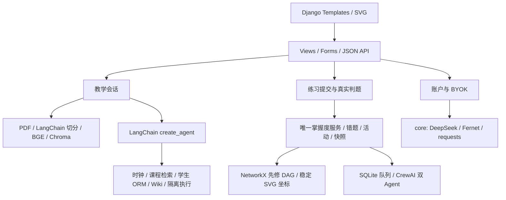

# 工程架构与决策

## 模块边界

Django 模块化单体，SQLite 持久化用户状态，无 Node 工程、Redis、Celery 或微服务。页面层只解析请求和返回模板 / JSON；服务组织业务事务；领域算法独立于 HTTP；core 提供 LLM、加密、异常与隔离执行适配。

knowledge 管理 Course、Chapter、KnowledgePoint、KnowledgeRelation、Document、Chunk、Correction。problems 管理 Problem、ProblemKnowledgePoint、TestCase、Submission、TestResult、ExecutionRequest。learning 管理 LearningActivity、MistakeRecord、MasteryState、MasterySnapshot。tutor 管理 ChatSession、ChatMessage、TeachingSession。accounts 管理用户配置及个人请求预算。agents 管理 AgentTrace、ToolInvocation。reports 管理 ReportTask、LearningReport。

## RAG

PDF 按实际页码提取，LangChain RecursiveCharacterTextSplitter 按段落与中文标点切分，650 字符块、80 重叠。原文文档哈希和 Embedding 标识生成稳定索引版本；Chroma 使用 cosine，文件与向量维度不混合。元数据包括文件名、哈希、章节、节、页码、chunk ID、来源类型和版本。首次入库之外不重复向量化 PDF；BGE 模型与词向量缓存独立。

默认本地 BGE 中文语义 Embedding，revision 与维度记录在数据库中。tfidf 是可配置、显式标记的字符词法基线，不能冒充 BGE。当前小型检索实验不足以证明混合检索有额外收益，因此未添加 BM25/RRF 等额外路径。证据门槛以实际库内/库外查询校验，仍需要更多问题校准，不能视为完美语义边界。

课程问答先取得真实证据再交给 Agent，模型引用编号经过服务器核对，前端显示数据库中的片段。没有内联引用时检索片段以独立参考证据展示，不能被解释为模型已经正确引用。教师原文中的 BF 下标和三对角公式问题以待审核 Correction 保留，教师审核后才进入问答证据。原始 PDF 不变。

## Agent 与模型

LangChain 当前 create_agent API，模型通过独立 BaseChatModel 适配 DeepSeek requests。多轮工具调用保留 reasoning_content 于运行内消息状态，用户聊天与 Trace 不保存推理字段。五个 StructuredTool 通过 Pydantic 输入约束，身份从认证上下文闭包绑定，模型不能提供任意 student_id。

每次工具调用保存真实开始时间、状态、耗时、错误类型与脱敏输入长度。限制重复签名、工具次数、总任务 deadline 和模型预算。工具结果、检索 PDF 和外部网页都属于不可信参考数据，不具备授权能力。没有凭据时抛出明确错误，不返回伪造 Agent 回答。

ModelRegistry 集中定义三个运行档位，使用明确模型与思考参数；返回模型校验可识别官方版本别名，意外替换报错。LLMProvider、EmbeddingProvider、VectorStore、CodeExecutionProvider、ExternalKnowledgeProvider、MasteryEstimator、GraphLayoutProvider 对应各自实际可替换边界，使用 Protocol / dataclass。

## 判题与一致性

学生代码只能发送到隔离执行服务。Piston、Judge0 适配真实接口；Judge0 使用提交 token 轮询；requests 禁止重定向，读取响应有大小上限。标准判题服务端管理隐藏用例；浏览器只能获得隐藏用例的序号、状态与耗时，不能得到输入、预期输出、原始输出或 traceback。

先原子持久化 PENDING 与请求幂等键，释放事务后外部评测，再在 SQLite IMMEDIATE 事务中提交结果、写入去重活动、更新错题和掌握度快照。JUDGE_ERROR 不产生掌握证据。相同请求键不得被复用为不同题目或代码；重复响应不重复记分。

## 掌握度与 BKT

规则指数：`100 × (0.35 × 题目覆盖 + 0.40 × 近期加权正确率 + 0.15 × 独立完成 + 0.10 × 难度表现)`。最近窗口默认八次，权重随时间顺序增加。覆盖按不同通过题目计算，重复刷同一道题不能增加覆盖。单一题目最高 55；至少五份证据、三个不同题目才解除不足证据限制，缺少任一则指数最多 84。近期错误可使指数下降，提示次数来自保存的教学状态并可记录学生自报值。参数集中于 mastery_service。

BKT 采用初始、学习转移、猜对、失误四参数贝叶斯更新，工程先验未拟合；规则指数和 BKT 概率分别保存与标记，切换估计器不会把两个数字混为同一含义。教师应在更大数据集上校准先验。

图谱由共享稳定结构和当前用户进度组合。章/课程指数按全部子知识点难度权重聚合；无证据点贡献零值，单点通过不会令整章掌握。NetworkX 检查先修环，用拓扑排序生成目标的先修路径，related 与 prerequisite 严格分开。历史图读取真实 Snapshot，没有记录不合成历史。Python 产生链表反转、KMP、BF、循环队列和栈的状态；浏览器只负责动画渲染。

## CrewAI 与任务恢复

数据库统计先确定提交数、去重题目数、正确率、每日趋势、知识点与错题表现、快照变化。生成时读取保存的学生快照。真实 Researcher / Writer、两个 Task、Process.sequential、crew.kickoff()，独立 service。写手结构化 metrics 必须等于快照；分析文本不得引入未经核验的数值，客观 Markdown 表格由 Python 渲染。

ReportTask 保存 PENDING/RUNNING/SUCCESS/FAILED/TIMEOUT，Worker 原子领取；每任务在可终止子进程运行，达到期限强制终止。这是可信应用工作进程，不用于执行学生代码。任务超时后不能发布迟到结果；没有 Worker 时有队列过期路径。选择模型档位在入队时冻结，之后更改个人默认档位不改变已排队任务。

## 密钥与权限

Django 自带认证 / CSRF / 会话。个人 Key 使用 Fernet，加密主密钥来自 `.env`；MultiFernet 支持旧密钥解密与轮换。只显示最后四位掩码，不返回完整 Key，不写浏览器存储、不写日志与 Trace。服务器地址仅由管理员环境变量配置，学生不能改变。每日和每分钟预算通过数据库事务预留；usage 缺失时不把未知消耗当零。详情 API 都按当前用户过滤，认证失败返回统一 401。

## Wikipedia 与外部服务降级（增量）

现有 WikipediaProvider 委托唯一 wikipedia_service：官方 Action API 搜索、保守标题匹配、摘要/修订/来源校验，Cache Aside 写入 SQLite WikipediaCache。共享缓存只包含公开词条与规范化公共别名，不保存完整私人问题。默认有效期七天；失败保留旧内容，并在来源卡片标明缓存时间、过期状态、语言、修订与许可。

LangChain 保留 create_agent 及原工具，新增 search_wikipedia 注册名。明确来源请求、课程证据不足的安全公开概念通过 wrap_model_call 中间件调用真实注册工具，再将结果作为不可信证据交给模型；结果和 Trace 来自实际执行。当前 DeepSeek thinking 不支持强制 named tool_choice，因此该路由不改变模型或思考模式。百科来源与课程来源分开校验与展示，个人学习数据仍由原 ORM 工具取得。

ServiceAvailability 持久保存 DeepSeek、Wikipedia、执行服务各自状态。业务请求更新成功/失败，普通状态 GET 无外网探测。全局网络错误、个人授权/额度错误、具体模型错误分开存储；冷却后原子领取半开尝试，真实成功恢复。百科缓存命中不会虚构在线状态。CodeDraft 按用户和题目/实验区保存，不产生提交或掌握证据。

BGE 查询默认 local_files_only，prepare_embedding_model 负责显式下载；向量标识与维度没有变化。生产配置通过 WhiteNoise 提供 collectstatic 后的静态文件，原生页面无 CDN 运行依赖。离线冷启动脚本在新进程、一次性数据库副本和外网 socket/DNS 阻断下启动实际 WSGI，检查课程、图谱、算法、缓存与本地 Piston，不更改主机网络或真实学生记录。
