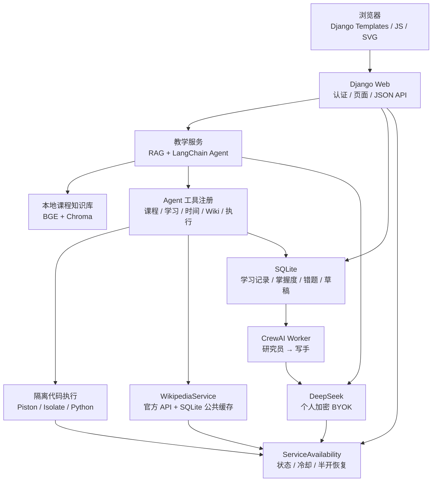

# 数构智学 AlgoMentor 面试答辩材料

> 用途：项目面试、课程设计答辩、软件工程实践汇报。
>
> 版本依据：当前仓库 `main`，提交 `475b245`。以下技术数据以代码、测试证据和本地运行结果为准。

## 一、30 秒项目介绍

我开发的是“数构智学 AlgoMentor”，一个面向数据结构与算法课程的智能助教平台。

它把课程 PDF、RAG 检索、LangChain 多工具 Agent、隔离代码评测、知识追踪、错题推荐和 CrewAI 学习报告串成一个闭环：学生先通过课程证据理解概念，再通过真实代码评测验证掌握情况，系统根据有效评测结果更新知识点掌握度和错题状态，最后给出下一步学习建议。

本项目的一个特色是同时支持在线和离线增强场景。在线时，课程 RAG 优先，必要时通过 Wikipedia 官方 Action API 补充公开概念；外部服务不可用时，本地 BGE、Chroma、SQLite、历史百科缓存、知识网络和算法可视化仍然可以工作。DeepSeek、Wikipedia 和代码执行服务分别维护状态，不会因为一个外部服务故障而关闭整个平台。

## 二、项目基本信息

| 项目 | 实际内容 |
| --- | --- |
| 项目名称 | 数构智学 AlgoMentor |
| 项目类型 | 数据结构与算法智能助教平台 |
| 后端 | Python 3.12、Django 5.2、SQLite |
| 知识库 | 教师 PDF、pypdf、LangChain Text Splitter、Chroma |
| Embedding | 本地 `BAAI/bge-small-zh-v1.5`，512 维 |
| Agent | LangChain `create_agent`、StructuredTool、Pydantic |
| 大模型 | DeepSeek OpenAI 兼容 API，三档运行配置 |
| 学习报告 | CrewAI，Researcher → Writer 顺序协作 |
| 代码执行 | 独立 Piston / Isolate，当前本机为 Lima VM + Python 3.12.0 |
| 前端 | Django Templates、原生 CSS、JavaScript、SVG，无 Node 前端工程 |
| 课程规模 | 45 个知识点、54 条关系、21 道练习、89 个评测用例 |
| 回归测试 | 320 passed、2 skipped；两项默认跳过的真实集成测试已单独通过 |

## 三、项目要解决的问题

传统课程平台通常把“看资料”“问问题”“写代码”和“查看成绩”分开，学生很难形成连续反馈，教师也很难从一次提交判断学生是否真正掌握了知识点。

本项目主要解决三个问题：

1. **回答要有课程依据。** 通过本地课程 RAG 返回原文和页码，减少模型脱离课程内容回答。
2. **学习效果要有真实证据。** 只有隔离执行服务完成的有效评测结果才会进入学习记录、错题和掌握度计算。
3. **平台要有可用边界。** DeepSeek、Wikipedia 和代码执行分别降级；外网不可用时，本地学习功能继续可用，并明确告诉用户哪些能力暂不可用。

## 四、系统架构讲解

### 1. 整体架构



### 2. 一次完整学习闭环

```text
学生提问
  → 检索课程原文
  → 课程证据足够：优先回答
  → 证据不足或明确要求：调用 Wikipedia
  → DeepSeek 组织教学回答
  → 学生编写 Python
  → Piston 隔离执行题目测试集
  → 有效提交进入学习证据
  → 更新规则掌握指数、BKT 概率、错题和知识图谱
  → 推荐下一道练习或生成学习报告
```

### 3. 代码目录定位

| 目录 / 文件 | 答辩时可说明的内容 |
| --- | --- |
| `apps/knowledge/services/retrieval_service.py` | 课程 PDF 片段的本地向量检索 |
| `apps/knowledge/services/wikipedia_service.py` | Wikipedia 搜索、摘要、来源校验、缓存和离线回退的唯一实现 |
| `apps/agents/services/agent_service.py` | Agent 请求入口、模型预检和来源返回 |
| `apps/agents/services/tool_registry.py` | LangChain 工具注册，含 `search_wikipedia` |
| `apps/learning/services/mastery_service.py` | 规则掌握指数、BKT 概率和评测证据写入 |
| `core/services/availability.py` | DeepSeek、Wikipedia、代码执行的持久化状态和冷却恢复 |
| `core/execution/piston_client.py` | Piston 请求、资源限制、结果归一化 |
| `apps/reports/services/crew_service.py` | CrewAI 学习报告内容生成 |
| `apps/problems/models.py` | 题目、提交和私有代码草稿 |
| `scripts/offline_probe.py` | 新 WSGI 进程、外部网络阻断、离线冷启动验证 |

## 五、核心功能答辩话术

### 1. RAG 知识库问答

课程 PDF 先按页提取文本，保留页码、章节、文档哈希和来源信息，再使用 LangChain 文本切分器生成重叠片段。默认块大小为 650 字符、重叠 80 字符，使用本地 BGE 生成 512 维向量并写入 Chroma。

查询时先从本地向量库取得相关课程证据，低于 `RAG_MIN_SCORE=0.45` 的结果会被过滤，默认返回前 4 个有效片段。服务端验证引用编号，再交给 Agent。回答展示的是数据库中实际存在的片段和页码，避免模型自己编造来源。课程证据不足时，系统会明确说明覆盖范围，必要时才使用外部百科资料。

### 2. LangChain Agent 与工具调用

Agent 使用 LangChain 的 `create_agent`，工具通过 StructuredTool 和 Pydantic 做参数校验。主要工具包括课程检索、学生学习数据查询、Python 执行、时间查询以及 Wikipedia 查询。

学生身份不由模型传入，而是从当前认证上下文绑定，因此模型不能通过参数读取其他学生的记录。每个工具调用都会记录真实的状态、耗时和错误类型，日志不保存完整密钥或模型推理字段。单次 Agent 最多调用 8 次、总时限 90 秒，并检测重复工具循环。

### 3. Wikipedia 真实检索和缓存

Wikipedia 服务固定访问中英文官方 MediaWiki Action API。流程是：搜索候选条目、进行标题相关性判断、获取摘要和页面信息、校验来源 URL、保存页面 ID、修订编号、语言、获取时间和许可证。

缓存采用 cache-aside：先读 SQLite 公共缓存，有效缓存直接返回；实时查询成功后写入缓存，默认 TTL 为 7 天；刷新失败时可以回退到历史内容，但页面会标记“历史缓存”并保留原获取时间。缓存只保存公开词条和公开概念别名，不保存学生聊天全文、学习记录或 API Key。

### 4. 在线代码运行和评测

学生代码不会在 Django 进程中执行，而是发送到独立 Piston 服务。当前本机运行在独立 Lima VM 中，VM 不挂载项目目录、数据库或密钥，程序受 CPU、内存、时间和输出长度限制。

“运行代码”用于自定义输入调试；“提交评测”执行完整测试集。系统区分通过、答案错误、语法错误、运行错误、时间超限和执行服务错误。基础设施故障只记录为 `JUDGE_ERROR`，不会计入正确率、错题或掌握度。

### 5. 学习分析和掌握度

有效提交通过事务写入学习证据，并使用事件键去重，避免重复提交重复记分。当前规则掌握指数为：

```text
100 ×（0.35 × 题目覆盖率
     + 0.40 × 近期加权正确率
     + 0.15 × 独立完成度
     + 0.10 × 难度表现）
```

重复通过同一道题不会增加覆盖率，单题证据有上限；达到高掌握状态还要求足够的证据量和不同题目。系统同时计算 BKT 概率，当前配置为 `initial=0.15`、`learn=0.12`、`guess=0.20`、`slip=0.10`；这些是可配置的工程先验，不能表述为经过大规模数据拟合的测量模型。

### 6. CrewAI 学习报告

报告先保存统计快照，再将任务放入 SQLite 队列，由独立 Worker 处理。Researcher Agent 分析趋势、掌握度、错题和薄弱点，Writer Agent 依据研究结论生成中文报告。客观数字由 Python 根据快照渲染，模型不能自行改写统计数字；任务有等待、运行、成功、失败和超时状态。

### 7. 离线学习和服务恢复

离线指“外部互联网不可用，但本地 Django 仍可访问”，不是浏览器脱离云端后的完整 PWA。

离线前需要准备本地 BGE、Chroma、SQLite、静态资源和历史百科缓存。之后可以继续课程检索、知识网络、算法可视化、学习记录、错题、规则推荐、历史报告和本地代码草稿。本机 Piston VM 运行时还可以继续执行代码。

DeepSeek、Wikipedia 和代码执行分别记录状态。状态读取只读数据库，不做后台网络探测；失败进入冷却，冷却结束后的下一次真实业务请求会尝试半开恢复，成功后更新为可用。个人密钥、余额和具体模型错误按用户 / 模型隔离。

## 六、8 分钟现场演示流程

### 第 1 分钟：项目定位

打开首页，说明平台不是单纯的聊天机器人，而是“课程证据 → 代码验证 → 学习追踪 → 个性化反馈”的闭环。

### 第 2 分钟：课程 RAG

进入课程知识库，搜索一个课程概念，展示返回的页码、原文链接和课程来源。强调回答依据来自教师 PDF，而不是无来源生成。

### 第 3 分钟：AI 助教

进入 AI 智能助教，选择教学模式，输入：

```text
请结合课程资料，引导我理解 KMP 的 next 数组，先不要直接给完整代码。
```

展示课程来源、提示层级和工具调用记录。若要演示外部知识，可以输入：

```text
使用维基百科查询红黑树，并说明它和普通二叉搜索树的区别。
```

### 第 4 分钟：独立 Wikipedia 查询

进入 Wikipedia 百科查询，勾选“仅查本地缓存”，查询“红黑树”。展示页面 ID、修订号、中文语言、缓存时间、原始链接和 CC BY-SA 4.0 署名。

说明这个入口不需要 DeepSeek Key，也不会调用 LLM。

### 第 5 分钟：代码评测

进入在线练习，先用自定义输入运行代码，再提交完整测试集。展示状态、耗时和测试结果，并说明只有有效提交才进入学习证据。

### 第 6 分钟：知识图谱

进入知识网络，打开一个知识点，说明颜色、掌握指数、证据数量、先修关系和历史快照来源于 SQLite 中的真实学习记录。

### 第 7 分钟：本地学习

进入本地学习，查询“循环队列如何判断队满？”。展示课程原文片段和页码，强调页面明确标注“没有调用大模型生成解释”。

### 第 8 分钟：服务状态和总结

展示顶部服务状态。说明三个外部服务独立降级，百科缓存命中不会虚构在线状态；若外部服务恢复，下一次真实请求会更新状态。

## 七、高频面试问题与参考回答

### Q1：为什么要使用 RAG，而不是直接让大模型回答？

因为这是课程场景，回答必须与教师资料一致。RAG 可以把课程原文、章节和页码作为证据传给模型，降低幻觉并支持来源追溯。大模型负责理解和组织，课程知识库负责提供可验证依据。

### Q2：为什么 Embedding 要放在本地？

一是保护课程资料和学习问题，二是保证离线检索可用，三是避免每次查询都依赖外部 Embedding API。项目把 BGE 模型和 Chroma 索引作为本地运行资源，默认 `local_files_only=True`，首次下载通过显式管理命令完成。

### Q3：如何判断 RAG 的引用不是模型编造的？

引用编号不是由前端或模型直接决定，而是服务端从检索结果生成并校验。前端展示的是数据库中真实的 chunk、文档和页码；如果没有有效证据，页面不会把模型文本包装成课程来源。

### Q4：Agent 和普通的函数调用有什么区别？

函数调用只是执行一个指定函数；Agent 还要根据用户目标和工具结果决定下一步动作。项目使用 LangChain `create_agent` 组织多轮任务，同时通过工具预算、重复签名限制、总时限和 Pydantic 参数约束控制 Agent 行为。

### Q5：为什么 Wikipedia 不直接把用户问题全文发出去？

用户问题可能包含姓名、成绩、聊天内容或 Key。系统先提取公开概念，只允许安全的公开查询词进入百科服务；缓存键使用规范化公开标题和别名，不保存私人上下文。

### Q6：为什么有了缓存还需要服务状态？

缓存只能说明某篇资料过去拿到过，不能说明 Wikipedia 当前在线。服务状态记录最近一次真实调用，缓存命中不会把服务伪装成在线。这样页面既能继续展示历史内容，又能准确提示实时服务状态。

### Q7：服务状态为什么不在后台定时请求？

后台探测会消耗 DeepSeek 额度，也可能造成额外限流。项目采用业务调用驱动状态：读取状态是纯本地读，失败进入冷却，冷却后的下一次真实业务调用负责恢复。

### Q8：如何保证学生代码安全？

代码不在 Django 进程执行，而是进入独立 Piston / Isolate。当前本机使用独立 Lima VM，VM 不挂载项目、数据库或密钥；请求限制运行时间、CPU、内存和输出，并禁止学生程序访问外网。

### Q9：评测服务挂了会不会影响学生成绩？

不会。执行服务异常单独记录为 `JUDGE_ERROR`，不创建有效提交证据，不更新正确率、错题和掌握度。只有测试集得到明确结果后，才进入学习状态更新事务。

### Q10：如何避免重复提交重复增加掌握度？

提交结果和学习活动使用请求幂等键 / 事件键，学习活动在数据库约束下去重。掌握度更新放在事务中，并对用户行和知识点状态加锁，避免并发写入破坏统计。

### Q11：为什么掌握度不只看通过率？

只看通过率会被重复刷同一道简单题影响。当前指数同时考虑题目覆盖、近期表现、是否独立完成和题目难度，并限制单题证据上限；系统还保存 BKT 概率作为另一种解释维度。

### Q12：BKT 是不是经过真实学生数据训练的？

不是。项目中的 BKT 是可配置的工程先验，用来提供概率型辅助指标；当前图谱颜色和推荐主要依据规则掌握指数。我会明确区分工程实现和经过教育数据验证的测量模型。

### Q13：为什么选择 SQLite？

本项目面向课程规模和本地部署，SQLite 部署简单，适合保存账户、学习记录、任务队列和公共缓存，同时可以使用事务和唯一约束保证一致性。高并发生产环境需要进一步评估 PostgreSQL、任务队列和多实例部署。

### Q14：为什么报告使用独立 Worker？

CrewAI 报告可能耗时较长，如果在 Web 请求内执行会阻塞页面。SQLite 队列保存任务状态，Worker 原子领取任务，并对超时任务进行处理，页面只查询状态。

### Q15：离线模式是不是完整 PWA？

不是。离线模式的前提是本地或局域网 Django 仍然可以访问，并且模型、Chroma、静态文件和必要缓存已经准备。浏览器如果完全无法连接云端 Django，不属于本项目当前支持的范围。

### Q16：离线时 Wikipedia 能不能查询任何新词？

不能。离线只能读已经保存的历史缓存；没有缓存时明确返回无资料。实时 Wikipedia 查询仍然需要网络。

### Q17：本次测试是否真的访问了 Wikipedia？

是。指定的红黑树、KMP、二叉搜索树和 Dijkstra 查询全部成功，扩展查询合计 6/6；另有 18 项审核词表核对通过。LangChain 集成使用真实 Wikipedia HTTP，但规划模型使用了明确标注的测试替身，没有把它说成 DeepSeek 线上端到端验收。

### Q18：本次测试是否真的评测了代码？

是。真实 Piston 提交闭环测试通过，使用隔离测试数据库验证成绩和用户隔离；本机还完成 21 道题、89 个用例和六类判题实验。

### Q19：为什么自动测试有 skipped？

两个测试默认跳过是为了避免普通回归测试意外调用外部网络或真实执行服务。它们分别通过环境变量显式启用，并已单独执行通过。这种设计把稳定的单元 / 集成回归和有外部依赖的验收测试分开。

### Q20：项目目前最大的限制是什么？

DeepSeek 新生成和 CrewAI 报告需要有效 Key、额度和网络；Wikipedia 实时查询需要网络；远程代码执行服务不可达时无法评测。当前离线方案不是完整 PWA，也没有把三个 DeepSeek 档位和 CrewAI 线上质量都做成付费端到端验收。

## 八、容易被追问的技术细节

### 1. 缓存为什么选择 SQLite？

缓存和用户学习数据都需要持久化，并且项目部署目标是本地单体应用。SQLite 可以直接参与 Django ORM、事务、索引和权限边界，避免额外引入 Redis。缓存字段包括公开规范化查询、页面 ID、标题、摘要、语言、修订号、来源 URL、获取时间、过期时间和内容哈希。

### 2. 如何处理 Wikipedia 的歧义页和重定向？

服务端读取搜索候选并进行标题相关性排序，再使用页面摘要和页面信息接口；歧义页、缺失页、空摘要、异常 JSON 和无效来源 URL 都不会写入成功缓存。重定向后的实际标题、页面 ID 和 canonical URL 会作为来源信息返回。

### 3. 如何处理外部网络失败？

请求设置连接与读取超时、响应体大小限制、固定官方域名和来源 URL 白名单；请求失败记录服务状态。若已有缓存且开启回退，则返回历史内容并附带错误码和缓存警告；没有缓存就返回明确失败，不伪造答案。

### 4. 如何区分“学生代码错”和“执行服务挂”？

Piston 返回的语法错误、运行错误、超时和标准输出由适配层归一化为学生可见的判题结果；服务不可达、响应格式错误或内部错误由执行可用性装饰器记录为基础设施失败。只有后者进入服务故障状态，而且不写学习证据。

### 5. 为什么不把所有功能都交给 Agent？

成绩、掌握度、权限和数据库写入属于高约束业务，不应该由模型自由决定。Agent 只负责选择工具和组织解释；身份、预算、来源校验、事务、成绩和掌握度由服务端确定。

## 九、项目难点、解决方案和取舍

| 难点 | 解决方案 | 取舍 |
| --- | --- | --- |
| 课程回答可能产生幻觉 | 本地 RAG、页码来源、服务端引用校验 | 需要维护文档哈希和索引版本 |
| 外部百科不稳定 | 官方 API、来源白名单、SQLite cache-aside、历史回退 | 过期内容必须明确标识 |
| Agent 可能越权读取数据 | 工具闭包绑定当前用户，Pydantic 校验参数 | 工具开发需要更严格的身份测试 |
| 学生代码有安全风险 | 独立 VM、资源限制、禁网、无项目挂载 | 部署依赖 Lima / Piston 运行环境 |
| 服务故障不能污染成绩 | 执行结果和学习证据分层，事务内幂等更新 | 业务流程比直接保存结果更复杂 |
| 外网断开后仍可学习 | 本地 BGE、Chroma、历史百科缓存、服务独立降级 | 不承诺浏览器脱离 Django 的完整离线 |
| 报告生成较慢 | SQLite 队列 + 独立 Worker + 超时状态 | 需要额外维护 Worker 进程 |
| 不引入大型前端工程 | Templates + 原生 JS / SVG | 交互组件需要自己维护 |

## 十、测试和证据怎么回答

回答测试时建议按三层说：

1. **自动回归：** 最终 320 项通过、2 项默认跳过；跳过项分别显式运行后通过。
2. **真实外部集成：** Wikipedia 官方 API 实际查询 6/6；LangChain + Wikipedia 集成通过；Piston 真实提交闭环通过。
3. **离线和数据安全：** 离线冷启动在新 WSGI 进程、一次性数据库副本、外部 DNS/socket 阻断条件下通过；既有账户、聊天、提交、掌握度、错题和报告行的只读指纹未变化。本轮验证没有调用用户付费 DeepSeek。

不要说“所有线上功能都已经在生产环境验收”。准确说法是：核心本地流程和真实 Wikipedia / Piston 集成已验证，付费 DeepSeek 三档线上推理和 CrewAI 生产质量仍需部署环境单独验证。

## 十一、现场演示前检查清单

- [ ] `127.0.0.1:8000` 可以打开，测试账号可以登录。
- [ ] 页面状态能正常显示；如果没有 DeepSeek Key，提前说明本次演示使用本地知识和独立百科页面。
- [ ] Wikipedia 缓存已有“红黑树”或其他稳定词条。
- [ ] Piston VM 已启动，执行 `manage.py check_execution_service` 能通过。
- [ ] Chroma 索引和本地 BGE 已准备，课程知识库可以返回页码。
- [ ] 报告 Worker 已启动；若不演示报告，可说明它是异步能力。
- [ ] 浏览器打开课程知识库、AI 助教、Wikipedia、本地学习、在线练习和知识网络页面。
- [ ] 不在演示或投屏中展示 `.env`、完整 API Key、SQLite 文件、个人聊天内容或学生真实数据。

## 十二、可直接背诵的结尾

这个项目的核心不是把多个 AI 名词堆在一起，而是把课程知识、模型能力、真实执行和学习数据连接起来。课程 RAG 保证回答有依据，隔离评测保证学习证据真实，知识追踪把一次次练习转化为可解释的掌握状态，Wikipedia 和离线机制保证外部服务不稳定时仍然可以学习。同时，服务端保留了权限、预算、事务和执行隔离边界，模型只负责适合它的解释和工具选择。

下一步如果继续完善，我会优先做三件事：第一，收集更多匿名学习轨迹，对 BKT 参数和推荐策略做离线评估；第二，为多实例部署评估 PostgreSQL、任务队列和共享缓存；第三，在获得明确预算与数据授权后，对不同 DeepSeek 档位和 CrewAI 报告质量做系统化线上评测。

## 十三、常用命令速查

```bash
# 启动 Web
.venv/bin/python manage.py runserver 127.0.0.1:8000

# 启动报告 Worker
.venv/bin/python manage.py report_worker

# 检查本地模型
.venv/bin/python manage.py prepare_embedding_model --check-only

# 预热 Wikipedia 公共缓存
.venv/bin/python manage.py warmup_wikipedia --query '红黑树' --query 'KMP算法' --interval 1

# 离线验收
.venv/bin/python manage.py collectstatic --noinput --settings=config.settings.production
.venv/bin/python scripts/verify_offline.py

# 自动测试
.venv/bin/pytest -q
```

## 十四、相关文档

- [README.md](README.md)：项目完整说明、安装和使用方式。
- [ARCHITECTURE.md](ARCHITECTURE.md)：模块边界、RAG、Agent、事务和服务降级设计。
- [WIKIPEDIA_OFFLINE_REPORT.md](WIKIPEDIA_OFFLINE_REPORT.md)：本轮增量开发、逐文件修改和验收证据。
- [TESTING.md](TESTING.md)：测试范围和结果解释。
- [SECURITY.md](SECURITY.md)：密钥、权限和代码执行边界。
- [deployment/LOCAL_EXECUTION.md](deployment/LOCAL_EXECUTION.md)：本机隔离执行环境。
