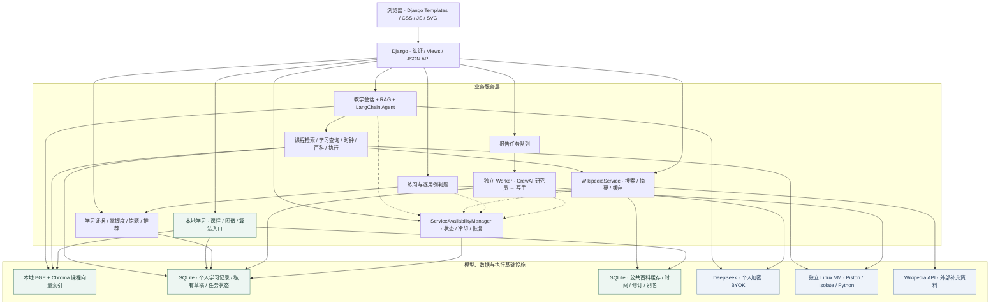

<p align="center">
  
</p>

<h1 align="center">数构智学 · AlgoMentor</h1>

<p align="center"><strong>基于多工具智能体、可信知识检索与知识追踪的数据结构与算法智能助教平台</strong></p>

<p align="center">
  
  
  
  
</p>

<p align="center">课程证据与百科补充 · 在线智能教学 · 离线本地学习 · 真实评测与掌握度追踪</p>

<p align="center">
  <a href="#introduction">项目介绍</a> ·
  <a href="#features">功能实现</a> ·
  <a href="#architecture">技术架构</a> ·
  <a href="#installation">安装运行</a> ·
  <a href="#usage">使用说明</a> ·
  <a href="#notes">注意事项</a>
</p>

---

<a id="introduction"></a>

## 一、项目介绍

### 1. 项目背景

数据结构与算法学习同时涉及抽象概念、算法过程、代码实现和复杂度分析。学生即使记住定义，也可能难以判断自己的理解是否正确；单次代码通过也不足以说明已经掌握相关知识。课程资料、练习结果和学习建议之间需要形成连续的反馈。

数构智学围绕这一过程设计：以教师提供的课程文档作为知识依据，通过智能助教解释与引导，通过隔离执行验证程序，再把真实练习结果转化为知识点掌握状态、错题记录和后续训练建议。

### 2. 项目简介

**AlgoMentor 是面向数据结构与算法课程的 Django Web 应用。** 它将 RAG、LangChain 工具调用、在线判题、知识追踪和 CrewAI 学习报告整合到一个学习工作台。

主应用采用 **Python 3.12、Django 5.2 和 SQLite**，页面由 Django Templates 与原生 CSS、JavaScript、SVG 构成。课程向量检索使用本地中文 BGE 模型与 Chroma；学生程序交由独立 Piston / Isolate 服务执行。

联网时，助教优先检索课程证据，必要时调用 Wikipedia 官方 API 补充公开概念，再由 DeepSeek 整合回答。外网不可用时，在本地 Django、模型与索引已准备的前提下，学生仍可检索课程原文、读取百科历史缓存、使用知识网络与算法演示，并保存本地学习数据。各外部服务独立降级，冷却后通过实际请求确认恢复。

随项目提供的课程结构包含 **45 个知识点、54 条知识关系、21 道原创练习及 89 个评测用例**，覆盖算法基础、线性表、栈与队列、字符串匹配和数组存储等内容。原始课程 PDF 保存在仓库中，回答来源可以追溯到具体页码与原文片段。

### 3. 系统整体功能

| 学习环节 | 主要能力 | 对应页面 |
| --- | --- | --- |
| 理解课程 | 课程检索、原文追溯、RAG 问答、分层提示 | 课程知识库、AI 智能助教 |
| 扩展概念 | Wikipedia 真实摘要、中英文来源、时间与修订、持久化缓存 | Wikipedia 百科查询 |
| 离线学习 | 本地课程检索、百科历史缓存、已有学习记录与规则推荐 | 本地学习 |
| 验证程序 | Python 运行、标准输入输出、完整测试集评测 | 在线练习 |
| 观察算法 | 指针、匹配过程、队列与栈状态逐步演示 | 算法实验室 |
| 追踪掌握 | 知识点进度、先修路径、历史快照 | 知识网络 |
| 改进训练 | 错题重做、薄弱点分析、个性化题目推荐 | 智能错题本、学习分析 |
| 回顾学习 | 真实统计、CrewAI 分析、下一阶段建议 | 学习报告 |

新账户从空学习记录开始。只有有效评测结果才形成做题证据；聊天、提示和基础设施错误不会被当作通过成绩。

<a id="features"></a>

## 二、项目功能实现

### 1. RAG 知识库问答

知识库按 **PDF 提取 → 文本切分 → 向量化 → Chroma 入库 → 相似度检索 → 带证据回答** 的流程构建。

- 使用 pypdf 按页提取教师原始 PDF，保留文件名、章节、节、页码和文档哈希。
- 使用 LangChain 文本切分器生成重叠片段；默认块大小为 650 字符，重叠 80 字符。
- 使用本地 `BAAI/bge-small-zh-v1.5` 生成 512 维中文语义向量，模型 revision 与索引版本一并记录。
- 使用 Chroma 持久化检索，默认取相关性达标的前 4 个片段，作为助教回答的课程证据。
- 回答中的来源编号经过服务端核对，页面展示实际原文；教师勘误与原始资料分开管理，审核通过后才进入检索证据。

课程证据不足时，助教需要明确说明资料覆盖范围。外部补充资料单独标明来源；来源编号有效也不等于回答内容已经完成事实审核。

### 2. LangChain 智能体与工具调用

智能助教通过 LangChain 的真实 `create_agent` 运行多轮任务，并按需要调用五类工具（保留原注册名，同时增加明确的 `search_wikipedia` 入口）：

| 工具 | 实现能力 |
| --- | --- |
| `retrieve_course_knowledge` | 检索课程知识库，返回原文与出处 |
| `query_student_learning` | 查询当前登录学生的提交、掌握度和学习统计 |
| `execute_python_code` | 将 Python 程序发送至隔离执行服务，返回实际结果 |
| `get_current_time` | 获取系统当前时间与时区 |
| `search_external_knowledge` / `search_wikipedia` | 通过 Wikipedia 官方 Action API 查询中英文百科，支持持久化缓存 |

工具参数通过 Pydantic 校验，学生身份由服务端绑定。每次调用记录工具名称、状态、耗时、错误类型与脱敏摘要；页面只展示实际发生的调用。任务设置调用次数、重复调用和总时限约束。

### 3. 在线代码运行与自动评测

“运行代码”使用自定义输入，供学生调试；“提交评测”执行题目完整测试集，并形成正式提交记录。

```text
浏览器中的 Python 代码
        ↓
Django 校验请求与执行预算
        ↓
独立执行 VM 中的 Piston / Isolate
        ↓
逐用例结果 → 整体判题 → 学习证据更新
```

评测区分 `ACCEPTED`、`WRONG_ANSWER`、语法错误、运行错误、时间超限和可明确识别的内存超限。隐藏用例仅返回状态、序号及资源统计，其输入、预期输出与原始错误信息不返回浏览器。

本机已接通隔离 Python 3.12.0。独立 Lima VM 不挂载应用目录、数据库或密钥；学生执行禁网并受资源限制。服务故障记为 `JUDGE_ERROR`，页面显示“评测未完成 / 无有效成绩”，不计入正确率或掌握度。其他部署可通过统一执行接口接入管理员配置的 Piston 或 Judge0。

### 4. 学生数据管理与学习分析

SQLite 保存账户配置、教学会话、提交、用例结果、学习活动、错题、掌握度与报告。个人记录按当前登录用户查询，课程结构由所有用户共享。

提交使用请求幂等键；外部评测完成后，在同一事务内保存结果、生成去重学习证据、更新错题和掌握度快照。重复提交同一请求不会重复记分。

学习分析提供提交正确率、题目通过率、知识点覆盖、练习趋势和薄弱点等指标。缺少有效数据时显示“暂无证据”，基础设施失败从成绩统计中排除。

### 5. CrewAI 智能学习报告

报告由两个 Agent 按顺序协作生成：

| 角色 | 职责 |
| --- | --- |
| Researcher Agent · 学习研究员 | 根据数据库统计快照分析趋势、知识点表现、错题与薄弱点 |
| Writer Agent · 学习报告写手 | 依据研究员结论组织中文报告与下一阶段训练建议 |

系统实际使用 `Crew`、`Task`、`Process.sequential` 和 `crew.kickoff()`。任务先进入 SQLite 队列，再由独立 `report_worker` 处理，保存等待、运行、成功、失败或超时状态。

报告中的客观数字由 Python 根据快照渲染；模型返回的结构化指标必须与快照一致。内容包括学习概览、每日趋势、各知识点表现、主要错题类型、图谱变化、进步、薄弱点和后续建议。

### 6. DeepSeek 多模型切换

平台提供三个运行档位，模型标识与思考参数统一由 `ModelRegistry` 管理：

| 运行档位 | 请求模型 | 思考模式 | 使用场景 |
| --- | --- | --- | --- |
| DeepSeek 极速 | `deepseek-flash` | 关闭 | 概念解释、基础问答与轻量提示 |
| DeepSeek 深度 | `deepseek-flash` | 开启，默认 `high` | 算法推导、代码诊断与多步骤任务 |
| DeepSeek 专家 | `deepseek-v4-pro` | 开启，默认 `high` | 较复杂的算法问题与学习规划 |

三个档位对应两个模型标识与不同运行配置。思考档位支持 `low`、`high`、`max`；多轮工具调用保留所需的 `reasoning_content`，不将推理字段保存为用户聊天或工具日志。

用户通过网页配置自己的 API Key，密钥使用 Fernet 加密存储。系统统计真实接口 usage，并设置个人每日请求、Token 预算与每分钟限流；模型可用性取决于服务商和个人账户。

### 7. 动态知识网络与掌握度追踪

知识网络将课程、章节、知识点与先修关系组织为可交互 SVG 图谱。NetworkX 校验先修关系并生成学习路径；搜索、缩放、拖动、节点详情与历史快照帮助学生查看自己的学习位置。

默认掌握度采用可解释的规则指数：

```text
掌握指数 = 100 ×（0.35 × 题目覆盖率
               + 0.40 × 近期加权正确率
               + 0.15 × 独立完成度
               + 0.10 × 难度表现）
```

重复通过同一道题不会增加题目覆盖率；单题证据的指数上限为 55。达到较高掌握状态还需要足够的证据和不同题目，近期错误也可能使指数下降。

系统同时保存 BKT（Bayesian Knowledge Tracing）概率，并支持配置估计器。**规则指数与 BKT 概率分别展示；当前图谱颜色与推荐依据规则指数。** BKT 参数为尚未拟合的工程先验，不代表经过验证的能力测量。没有证据的知识点显示为灰色“未学习”，章节进度按全部子知识点加权聚合。

### 8. AI 自适应教学

教学会话保存目标知识点、关联题目、当前提示层级和已经提供的提示，支持三种教学模式：

| 模式 | 教学方式 |
| --- | --- |
| 直接讲解 | 解释定义、性质、例子、复杂度与常见误区 |
| 引导教学 | 先了解学生思路，再通过针对性问题逐步提示 |
| 算法思维训练 | 从题意、暴力解法和复杂度逐步推进到优化、正确性与边界验证 |

提示分为“指出方向 → 指出逻辑 → 解释方法 → 完整解析”四层，由学生通过“更多提示”或“完整解析”推进。助教结合会话上下文、课程证据和真实学习查询调整讲解；重新学习与结束会话也会保存状态。

### 9. 算法可视化

算法实验室提供五类演示，算法步骤由 Python 计算，浏览器使用原生 JavaScript / SVG 渲染：

| 演示 | 观察内容 |
| --- | --- |
| 单链表反转 | `prev`、`curr`、`next` 与指针方向变化 |
| KMP 匹配 | 模式串、next 数组、失配跳转与比较步骤 |
| BF 匹配 | 逐字符比较、失配回退，并可与 KMP 对照 |
| 循环队列 | 入队、出队、判空、判满与下标绕回 |
| 顺序栈 | 入栈、出栈及栈顶变化 |

支持播放、暂停、重置、前后步进和调整输入，用于观察算法状态与理解执行过程。

### 10. 智能错题本与个性化推荐

有效的错误提交自动进入错题本，保留错误类型、失败原因和原始提交。学生可查看分层诊断，配置 Key 后还可请求 AI 分析；再次通过相同题目后标记为已解决，历史错误仍保留。

推荐服务综合规则掌握指数、未解决错题、题目难度、目标先修关系、已经通过的题目和最近练习记录排序，提供“基础 / 巩固 / 挑战”三种训练模式。每个推荐附带理由与训练目标，方便学生判断下一步练习的目的。

### 11. Wikipedia 在线知识检索

助教可调用 Wikipedia 官方 MediaWiki Action API，先搜索并判断标题相关性，再获取真实摘要、页面 ID、修订编号和来源链接。用户明确指定维基百科，或本地课程证据不足且需要解释扩展概念时，会调用百科工具；课程资料已有充分证据时保持本地 RAG 优先。中文优先，必要时提供明确标记的英文来源。

普通查询先查 SQLite 有效缓存，再按需要联网；成功结果保存公开词条及概念别名，默认有效期七天。强制刷新绕过有效缓存，但仍遵守服务冷却；失败时按配置回退到明确标记的历史缓存，保留原获取时间。超时、限流、无结果、歧义条目与空摘要均返回明确提示。

课程引用与外部百科分别展示。百科卡片包含实际语言、获取时间、缓存状态、页面 ID、修订编号、原始链接及 CC BY-SA 4.0 署名。公共缓存只保存公开百科资料；查询会提取或校验公开概念，不把学生聊天全文、学习记录或个人 Key 发往 Wikipedia。

独立百科查询无需 DeepSeek Key；在 AI 助教中整合百科回答需要 Key。具体操作见第五章，管理员缓存预热见[安装与运行](#wikipedia-warmup)。

### 12. 离线学习支持

**离线学习要求本地或局域网 Django 服务仍可访问。** 预先安装依赖、下载本地 Embedding 并建立 Chroma 索引后，即使外部互联网不可用，也可使用本地知识检索、知识网络、算法可视化、学习记录、错题、规则推荐与历史报告。在课程知识库点击“本地学习模式”，可查询原文和已经缓存的百科内容；页面明确区分原文检索与 AI 生成。

| 能力 | 外网不可用时的行为 | 必要条件 |
| --- | --- | --- |
| 课程检索与原文阅读 | 本地检索，返回原文与页码 | BGE 模型和 Chroma 索引已准备 |
| Wikipedia 查询 | 仅返回已有缓存，标明历史时间；无缓存时说明无资料 | 相应词条曾成功查询或预热 |
| 知识网络、算法、错题、推荐与历史报告 | 使用本地数据继续浏览与学习 | Django 与 SQLite 可访问 |
| 代码编辑与草稿 | 按账号手动保存和载入，不自动评测 | 本地 Django 可访问 |
| 代码运行与正式评测 | 本机隔离 Piston 运行时可继续使用 | 独立执行 VM 和 Python 包已安装并启动 |
| 新 AI 回答、AI 诊断与 CrewAI 报告 | 提示服务不可用，保留历史记录 | 恢复 DeepSeek 网络、Key 与额度后可生成 |

DeepSeek、Wikipedia、代码执行分别记录真实调用状态，单个服务失败不会禁用其他本地功能。失败后进入限时冷却；到期后的实际业务请求可以尝试恢复，成功后更新为可用。状态读取不发起外网或付费模型探测，`UNKNOWN` 表示尚无调用记录。个人 Key、额度与具体模型错误按用户或模型隔离，不影响其他学生。

浏览器无法连接云端 Django 的情况不在本次离线支持范围内；平台未改造成完整 PWA。配置开关、真实联网与冷启动验证见 [Wikipedia 与离线增量报告](WIKIPEDIA_OFFLINE_REPORT.md)。

<a id="architecture"></a>

## 三、项目技术架构

### 1. 技术栈

| 层次 | 技术 | 作用 |
| --- | --- | --- |
| 运行环境 | Python 3.12 | 主应用、业务服务与算法计算；本机验证版本 3.12.14 |
| Web 框架 | Django 5.2.14 | 模板渲染、JSON API、认证、ORM、事务与后台管理 |
| 页面交互 | Django Templates、原生 CSS / JavaScript / SVG | 学习工作台、图谱和算法演示 |
| 业务数据 | SQLite | 用户、会话、提交、掌握度、错题与报告队列 |
| RAG | LangChain Text Splitters、Chroma 1.5.9 | 课程切分、向量持久化与检索 |
| 中文向量 | sentence-transformers 6.1.0、BGE | 本地语义 Embedding |
| 工具智能体 | LangChain 1.4.5、Pydantic | 工具规划、参数约束与调用追踪 |
| 多智能体报告 | CrewAI 1.15.27 | 学习研究员与写手顺序协作 |
| 模型接入 | DeepSeek HTTP API、自定义 LangChain / CrewAI 适配器 | 统一档位、思考参数、usage 与异常处理 |
| 外部知识 | requests、Wikipedia 官方 Action API、SQLite 缓存 | 公开概念检索、来源追溯与历史资料回退 |
| 服务恢复 | 持久化 ServiceAvailability、冷却与半开重试 | 独立服务状态、个人与模型故障隔离 |
| 本地静态资源 | WhiteNoise 6.12.0 | DEBUG=False 时提供 collectstatic 后的 CSS / JS / SVG |
| 代码执行 | Piston / Isolate；Judge0 适配 | 独立沙箱、资源限制与真实执行结果 |
| 图谱与文件 | NetworkX、pypdf | 先修 DAG、学习路径与 PDF 提取 |
| 安全与验证 | cryptography、Django 会话 / CSRF、pytest-django | 密钥加密、访问控制和隔离数据库测试 |

完整依赖版本锁定在 [requirements.txt](requirements.txt)，直接依赖见 [requirements.in](requirements.in)。前端没有构建步骤，无需安装 Node.js 或 npm。

### 2. 简要架构图



主应用采用模块化单体：页面与 API 处理输入输出，业务服务组织规则与事务，`core` 提供模型、加密、异常和执行接口。报告 Worker 独立运行；学生代码位于另一执行环境。页面展示的总览、知识网络和报告统计读取同一套学习数据。

本地学习入口直接读取 BGE / Chroma、SQLite 与百科缓存，不调用云端模型或 Wikipedia HTTP。百科服务供独立页面与 Agent 复用；普通缓存命中不会将外网状态标记为恢复。可用性管理器由真实业务调用更新，页面定时读取的是本地状态记录。

**核心数据流：** 有效评测 → 保存提交与用例结果 → 去重学习活动 → 掌握度与历史快照 → 错题状态、知识网络和训练推荐 → 报告统计快照。

```text
AlgoMentor/
├── apps/
│   ├── accounts/           # 注册登录、个人 Key、配置与预算
│   ├── knowledge/          # 课程 RAG、Wikipedia 服务/缓存与本地学习
│   ├── tutor/              # 聊天会话、教学模式与提示状态
│   ├── agents/             # LangChain Agent、工具与调用记录
│   ├── problems/           # 题库、运行评测与私有代码草稿
│   ├── learning/           # 学习证据、掌握度、错题与推荐
│   ├── graph/              # 知识网络、先修路径与算法状态
│   ├── reports/            # CrewAI、报告队列与 Worker
│   └── analytics/          # 实验与调用记录查询
├── core/                   # LLM / 执行接口、服务可用性、安全与统一异常
├── config/                 # 路由与开发 / 生产设置
├── templates/              # Django 页面模板
├── static/                 # CSS、JavaScript 与 SVG
├── knowledge/
│   ├── original/           # 教师原始 PDF
│   ├── processed/          # 提取文本与处理结果
│   └── wikipedia_keywords.json # 人工审核的双语预热词表
├── data/                   # SQLite、Chroma 与验证日志
├── deployment/             # 独立执行 VM 配置与部署说明
├── scripts/                # 初始化、运行环境与实验脚本
├── tests/                  # 集成测试与真实实验结果
├── .env.example            # 配置示例；真实密钥不入库
├── requirements.txt        # 锁定依赖
└── manage.py
```

详细边界、事务、公式与设计决策见 [ARCHITECTURE.md](ARCHITECTURE.md)。

<a id="installation"></a>

## 四、安装与运行

### 1. 环境要求

- **Python 3.12**，使用项目独立虚拟环境。
- 首次安装需要网络，以下载依赖、中文 BGE 模型和执行镜像；下载后的课程向量检索可在本机运行。
- 本机自动部署执行 VM 的脚本面向 **Apple Silicon Mac，需 Rosetta**。VM 配置为 2 CPU、3 GiB 内存和 12 GiB 稀疏磁盘，主应用与模型还需相应运行资源。
- 其他系统可部署管理员管理的 Piston / Judge0 实例，再配置执行接口。完整条件见 [本机执行部署](deployment/LOCAL_EXECUTION.md)。

以下命令使用 macOS / Linux Shell。DeepSeek 问答、AI 诊断和生成报告需要个人 API Key；课程浏览、图谱、算法演示及本机代码执行可独立使用。

### 2. 下载项目

从 GitHub 克隆项目，进入包含 `manage.py` 的项目根目录：

```bash
git clone https://github.com/Oookla28/AlgoMentor.git
cd AlgoMentor
```

也可解压交付的 `AlgoMentor-源码交付.zip`。已有源码时跳过下载。仓库与源码包不包含个人密钥、学生数据库、虚拟环境、模型缓存或执行 VM。

### 3. 安装依赖

```bash
python3.12 -m venv .venv
.venv/bin/python -m pip install -r requirements-dev.txt
.venv/bin/python -m pip check
```

`requirements-dev.txt` 同时安装主依赖和测试工具；仅安装运行依赖时使用 `requirements.txt`。后续命令统一使用 `.venv/bin/python`，确保运行在同一环境。

### 4. 初始化数据库

首次安装推荐使用引导脚本：

```bash
.venv/bin/python scripts/bootstrap.py
```

它依次完成以下工作：

| 步骤 | 初始化内容 |
| --- | --- |
| 创建配置 | `.env` 不存在时，生成随机 Django 密钥和 Fernet 主密钥，设置文件权限为 `0600` |
| 数据库迁移 | 建立 SQLite 业务表 |
| 初始化课程 | 写入章节、知识点、关系、练习与测试用例 |
| 导入课程资料 | 提取默认 PDF、下载 BGE 模型、写入 Chroma 索引并关联勘误 |

引导脚本不会创建学生账户或学习成绩。**首次使用时不要先复制空密钥的 `.env.example` 为 `.env`**；已存在的 `.env` 会被保留，应先确认其中密钥完整。

**已有环境升级本次增量版本**：先备份 `.env`、SQLite 与 Chroma，在项目根目录更新依赖并应用增量迁移。保留原有加密主密钥和学生数据，正常升级不需要重新初始化或重新导入课程。

```bash
.venv/bin/python -m pip install -r requirements-dev.txt
.venv/bin/python manage.py migrate
.venv/bin/python manage.py prepare_embedding_model --check-only
```

新配置具有默认值，可按需追加到已有 `.env`；配置完成后重启 Web 和报告 Worker。迁移新增百科缓存、服务状态和代码草稿，不清空原有业务表。

如需通过 Django 后台管理课程，可自行创建管理员：

```bash
.venv/bin/python manage.py createsuperuser
```

### 5. 导入知识库

`bootstrap.py` 已包含模型准备与默认课程资料导入。手动导入前，先准备本地模型；已有模型只需检查，缺失时再显式联网下载：

```bash
.venv/bin/python manage.py prepare_embedding_model --check-only
# 首次缺少模型时执行；此命令需要网络
.venv/bin/python manage.py prepare_embedding_model
```

模型准备完成后导入课程：

```bash
.venv/bin/python manage.py ingest_knowledge
.venv/bin/python manage.py seed_knowledge
```

默认读取 `knowledge/original/数据结构与算法知识库文档.pdf`。指定其他课程 PDF 时，先将文件放入该目录，再执行：

```bash
.venv/bin/python manage.py ingest_knowledge --path 'knowledge/original/新的课程资料.pdf'
```

相同文档哈希与索引配置会跳过重复入库。运行时默认只加载本地模型文件，正常检索不自动下载或悄悄切换模型。更换 Embedding 模型或 revision 后执行 `ingest_knowledge --rebuild`，避免混用向量维度。原始 PDF 应保持不变，课程新增内容与勘误需经过审核。

### 6. 启动项目

**第一步：准备本机代码执行服务。** 已安装的本机只需执行 `start`；新的 Apple Silicon Mac 首次执行以下完整流程：

```bash
.venv/bin/python scripts/install_lima_runtime.py
.venv/bin/python scripts/local_piston.py start
.venv/bin/python scripts/local_piston.py install-python
.venv/bin/python scripts/local_piston.py smoke
```

将以下三项写入已有 `.env`，保留原有 Django 与加密密钥：

```dotenv
EXECUTION_PROVIDER=piston
PISTON_BASE_URL=http://127.0.0.1:2000/api/v2
PISTON_PYTHON_VERSION=3.12.0
```

然后检查实际执行能力：

```bash
.venv/bin/python manage.py check_execution_service
```

**第二步：启动 Web 服务。**

```bash
.venv/bin/python manage.py runserver 127.0.0.1:8000
```

浏览器访问 [http://127.0.0.1:8000/](http://127.0.0.1:8000/)。

**第三步：另开终端启动报告 Worker。**

```bash
cd AlgoMentor
.venv/bin/python manage.py report_worker
```

两个终端都应位于项目根目录。修改 `.env` 后重启 Web 服务与 Worker。执行 VM 可通过 `scripts/local_piston.py status` 查询，或通过 `scripts/local_piston.py stop` 关闭；重启电脑后先执行 `start` 再使用判题。

<a id="wikipedia-warmup"></a>

**可选：预热 Wikipedia 缓存。** 联网时执行以下命令，将四个概念保存到本地公共缓存，便于随后离线阅读：

```bash
.venv/bin/python manage.py warmup_wikipedia --query '红黑树' --query 'KMP算法' --query '二叉搜索树' --query 'Dijkstra算法' --interval 1
```

不传 `--query` 时使用 `knowledge/wikipedia_keywords.json` 中的 18 项审核词表：

```bash
.venv/bin/python manage.py warmup_wikipedia --interval 1
```

已有有效缓存自动跳过，可中断后重跑。支持 `--language zh|en`、`--config`、`--limit` 和 `--force-refresh`；刷新仍遵守服务冷却。默认概念间隔一秒，最小为半秒，单次最多 50 项。应用启动不会自动批量预热。

<a id="usage"></a>

## 五、使用说明

### 1. 注册与登录

打开网站，选择“注册”创建个人账户，再进入学习工作台。首次登录的总览、错题和掌握度没有预置学生数据；课程结构与题库已可浏览。已有账号直接登录，历史记录按用户保留。

### 2. 配置 DeepSeek API Key

进入“个人设置”，填写个人 DeepSeek API Key，选择默认模型档位与推理强度，保存后点击“测试连接”。连接测试会发起真实模型请求并消耗少量 Token。

密钥保存后只显示掩码，可以更换或删除。模型使用统计依据真实 usage 展示；Token 统计不等于已扣费账单，实际余额与费用在服务商控制台查看。

### 3. 使用 AI 智能助教

进入“AI 智能助教”，选择教学模式和模型档位后输入问题。右侧可以查看课程来源、教学提示层级和实际工具调用记录；左侧可以继续已有会话。

可以从以下问题开始：

- “为什么链表不能像数组一样随机存取？请结合课程资料解释。”
- “请引导我理解 KMP 的 next 数组，先不要给出完整代码。”
- “查询我的学习记录，分析薄弱知识点并推荐下一道练习。”
- “请实际运行这段 Python 程序，并解释输出和边界情况。”

遇到困难时使用“更多提示”，需要完整说明时选择“完整解析”；“重新学习”和“结束会话”用于管理当前教学进度。

### 4. 使用在线代码评测

进入“在线练习”，选择题目，阅读输入输出、样例与复杂度说明，填写 Python 代码。

1. 在“自定义输入”填写调试数据，点击“运行代码”查看标准输出、错误与耗时。
2. 确认思路后点击“提交评测”，运行题目完整测试集。
3. 查看本题提交记录与结果；有效错误会进入错题本，通过结果会更新学习证据与图谱。

需要暂停时点击“保存草稿”，之后可用“载入草稿”恢复代码与输入。草稿按账号和题目 / 实验区隔离，只保存到 SQLite，不自动运行或形成学习成绩。

例如“基本操作次数”题可先用输入 `4` 验证输出 `10`。自定义运行不记为通过成绩；完整评测通过后可按页面入口查看参考实现。服务错误时先恢复执行服务，再重新提交。

### 5. 查看动态知识网络

进入“知识网络”，搜索并选择目标知识点，查看掌握指数、证据量、课程来源、关联练习和先修路径。图谱支持拖动与缩放；历史视图读取真实保存的快照。

灰色表示尚无学习证据。通过一个知识点的练习后，可以观察节点和章节进度变化，再依据先修路径安排学习顺序。

### 6. 使用算法可视化

进入“算法实验室”，选择链表反转、KMP、BF、循环队列或栈，按页面填写输入并生成步骤。使用播放、暂停和前后步进观察状态变化；字符串匹配演示可以对照 BF 与 KMP 的比较过程。

### 7. 查看学习记录与错题

“学习分析”展示练习趋势、题目通过情况、知识点覆盖与掌握表现；“智能错题本”可查看失败原因、复习记录和解决状态。

从错题入口重新练习，通过后会保留原始错误并标记解决。根据推荐理由选择基础、巩固或挑战训练，避免只反复刷已经通过的同一道题。

### 8. 生成学习报告

确认个人 Key 可用，并已启动 `report_worker`，进入“学习报告”提交生成任务。页面显示任务状态，成功后打开报告查看本周统计、知识点表现、错题分析和后续建议。

报告使用入队时保存的数据快照与模型档位；后续修改默认档位不会改变已经排队的任务。没有有效练习时，报告会说明缺少证据。

### 9. 使用 Wikipedia 查询

登录后进入 [Wikipedia 百科查询](http://127.0.0.1:8000/knowledge/wikipedia/)，输入公开概念，例如“红黑树”或“KMP算法”，选择中文优先或英文查询。该入口不调用 LLM，也不需要 DeepSeek Key。

- 普通查询：优先读取有效缓存，必要时联网。
- “尝试实时获取”：尝试刷新百科，失败回退会显示原因与历史标记。
- “仅查本地缓存”：不请求 Wikipedia 外网，无缓存时明确提示。

来源卡片可查看实际摘要、语言、获取时间、页面与修订编号，并打开原始词条。英文内容保留原文。在 AI 助教中输入“使用维基百科查询红黑树”可让 Agent 调用工具并整合解释，此流程需要可用的 DeepSeek Key。

### 10. 使用本地学习与查看服务状态

进入 [本地学习](http://127.0.0.1:8000/knowledge/local/)，输入课程问题，阅读检索片段、页码和原文链接；相关百科仅从历史缓存读取。页面会明确说明当前内容来自检索，没有调用大模型生成解释。

顶部服务状态分别展示 DeepSeek、Wikipedia 与代码执行最近的真实调用结果。展开可查看更新时间、错误原因与冷却提示；“刷新状态”只读取本地记录。冷却结束后重新执行相应业务请求，真实调用成功即恢复。个人密钥或余额错误需先在设置或服务商账户中解决。

外网不可用时可以继续打开知识网络、算法实验室、学习记录、错题和历史报告。保存代码草稿后，再按执行服务是否可用决定运行或评测；本地检索和草稿保存不会伪造通过记录。

<a id="notes"></a>

## 六、注意事项

### 配置与数据

本次增量的可选配置见 `.env.example`。以下默认值在缺少对应配置时仍会生效：

| 配置项 | 默认值 | 作用 |
| --- | --- | --- |
| `WIKIPEDIA_ENABLED` | `true` | 是否允许百科联网检索 |
| `WIKIPEDIA_DEFAULT_LANGUAGE` / `WIKIPEDIA_FALLBACK_LANGUAGE` | `zh` / `en` | 首选与补充语言 |
| `WIKIPEDIA_TIMEOUT` | `6` | 读取超时秒数；连接超时最多三秒 |
| `WIKIPEDIA_CACHE_TTL_DAYS` | `7` | 有效缓存天数 |
| `WIKIPEDIA_USER_AGENT` | 含项目链接的 AlgoMentor 标识 | 官方 API 请求身份；部署时可填写自己的维护联系信息 |
| `OFFLINE_FALLBACK_ENABLED` | `true` | 实时请求失败时是否回退历史缓存 |
| `EXTERNAL_SERVICE_CHECK_INTERVAL` | `60` | 失败冷却秒数；不代表后台付费探测周期 |
| `LOCAL_EMBEDDING_OFFLINE_MODE` | `true` | BGE 运行时只加载本地模型文件 |

- **妥善备份 `.env`、SQLite 与 Chroma。** Fernet 主密钥丢失后，已加密的个人 API Key 无法恢复；密钥轮换方法见 [SECURITY.md](SECURITY.md)。
- **控制模型调用成本。** 问答、连接测试、AI 诊断与报告生成会使用个人 Key 并消耗 Token；平台设有预算和限流。
- **核对重要课程结论。** 引用可以定位真实片段，但生成内容仍需对照原文。默认 BGE 模型 revision 已锁定；显式选择 TF-IDF 时是词法基线，不等同于语义检索。
- **保持执行隔离。** 不在 Django 进程中运行学生代码，不向执行 VM 挂载项目、数据库或密钥。默认运行请求为 2 秒 / 128 MiB；本机执行服务最大为 3 秒 / 256 MiB，并限制进程和输出。
- **按证据解释掌握度。** 规则指数与 BKT 是工程估计，BKT 先验尚未拟合；无记录不代表已掌握，单题通过也不代表掌握整个章节。
- **生产部署使用专用配置。** `runserver` 用于本机开发；正式部署需使用 `config.settings.production`、HTTPS、Gunicorn 与服务管理器；先执行 `collectstatic --settings=config.settings.production`，生产配置通过 WhiteNoise 提供本地静态资源。SQLite 适合当前课程规模，高并发部署需进一步评估。

### 常见问题

| 现象 | 处理方式 |
| --- | --- |
| 未配置 Key / 428 | 在个人设置中保存自己的 Key，再测试连接 |
| 密钥错误、余额不足或模型不可用 | 根据页面提示检查个人 Key、服务商账户与选择的模型 |
| 请求过于频繁 / 429 | 检查个人预算与服务限流，稍后重试 |
| 知识库尚未入库或索引配置变化 | 执行 `ingest_knowledge`；更换模型后使用 `--rebuild` |
| 本地 Embedding 模型缺失 | 联网执行 `prepare_embedding_model` 后用 `--check-only` 验证；再导入知识库 |
| Wikipedia 超时或冷却中 | 阅读已有缓存，按页面提示稍后重试；实时数据仍需网络 |
| 离线百科无结果 | 该概念尚未缓存，联网查询或主动预热后再离线使用 |
| 服务显示“尚未检测” | 表示没有当前配置下的真实调用记录，状态读取不会发起健康探测 |
| 评测未完成 / 执行服务不可用 | 执行 `local_piston.py start` 与 `manage.py check_execution_service`，恢复后重新提交 |
| 报告一直等待 | 检查独立 `report_worker` 是否正在运行 |
| 报告失败或超时 | 查看任务错误提示，检查 Key、额度与网络后重新生成 |
| 修改配置后没有生效 | 重启 Web 服务与 Worker；使用 `--noreload` 时代码修改也需重启 |

### 验证与验收

常规检查与自动测试：

```bash
.venv/bin/python manage.py check
.venv/bin/python manage.py makemigrations --check --dry-run
.venv/bin/python -m pip check
.venv/bin/pytest -q
```

实际执行服务验证：

```bash
.venv/bin/python manage.py verify_judge
.venv/bin/python manage.py verify_problem_bank
.venv/bin/python manage.py verify_execution_isolation
ALGOMENTOR_LIVE_EXECUTION=1 .venv/bin/pytest -q tests/integration/test_live_execution.py
```

本机已完成 21 题 / 89 用例和六类判题实测；真实提交闭环使用独立测试数据库验证。隔离探针结果为 8 项通过、0 项失败、1 项未验证：内存分配被终止，但 API 缺少 OOM 元数据，未独立证明终止原因。完整结果保存在 `tests/evaluation/`。

**Wikipedia 与离线增量验收（2026-10-13）：**

| 验证范围 | 实际结果 |
| --- | --- |
| 原版本自动回归 | 218 项通过，1 项默认跳过 |
| 增量后完整自动回归 | **320 项通过，2 项默认跳过**；两个真实集成测试已单独执行通过 |
| 官方 Wikipedia 联网 | 红黑树、KMP、二叉搜索树、Dijkstra 四项全部成功；扩展查询合计 6/6 |
| 人工审核预热词表 | 18/18 实际核对通过；循环队列采用英文 Circular buffer |
| LangChain + Wikipedia | 真实 Agent 与官方 API 集成通过；规划 LLM 明确使用测试替身 |
| Piston 提交闭环 | 真实隔离执行通过，使用 pytest 数据库验证成绩与用户隔离 |
| 离线冷启动 | 新 WSGI 进程阻断外部 DNS / socket 和主机代理后通过，本地模型、静态资源、课程、百科缓存与执行均可用 |
| 既有学生数据 | 账户、聊天、提交、掌握度、错题和报告行的只读指纹核对未变 |

离线验证前需完成模型与索引准备、创建至少一个注册账户、预热“红黑树”缓存，并启动本机 Piston（端口 2000）。收集本地静态资源后执行：

```bash
.venv/bin/python manage.py collectstatic --noinput --settings=config.settings.production
.venv/bin/python scripts/verify_offline.py
ALGOMENTOR_LIVE_WIKIPEDIA=1 .venv/bin/pytest -q tests/integration/test_live_wikipedia_agent.py
```

冷启动脚本在新进程中使用一次性数据库副本，测试进程仅允许本地验证服务器和 Piston，不修改主机网络或真实学生库，也不调用用户付费模型。脚本结果保存到 `tests/evaluation/offline_cold_start.json`。这是外网不可用条件下的本地功能验证，不是浏览器脱离 Django 后的完整离线应用。

常规自动测试中的付费模型使用明确的测试替身，不能当作三个档位、全部工具任务或 CrewAI 线上质量验收；这些环节需使用个人 Key 单独验证。本机部署也不等同于完成生产安全审计。

| 文档 | 内容 |
| --- | --- |
| [ARCHITECTURE.md](ARCHITECTURE.md) | 模块边界、RAG、事务、掌握度与任务恢复 |
| [deployment/LOCAL_EXECUTION.md](deployment/LOCAL_EXECUTION.md) | 本机隔离执行环境的安装、启动、停止与验收 |
| [SECURITY.md](SECURITY.md) | 密钥、权限、执行边界与生产要求 |
| [TESTING.md](TESTING.md) | 测试范围、真实实验与结果解释 |
| [WIKIPEDIA_OFFLINE_REPORT.md](WIKIPEDIA_OFFLINE_REPORT.md) | Wikipedia / 缓存 / 服务恢复 / 离线功能、逐文件修改与本轮验收 |
| [DELIVERY_REPORT.md](DELIVERY_REPORT.md) | 开发完成情况、验收证据与尚未验证的环节 |
| [DEVELOPMENT.md](DEVELOPMENT.md) | 开发命令与工程维护 |
